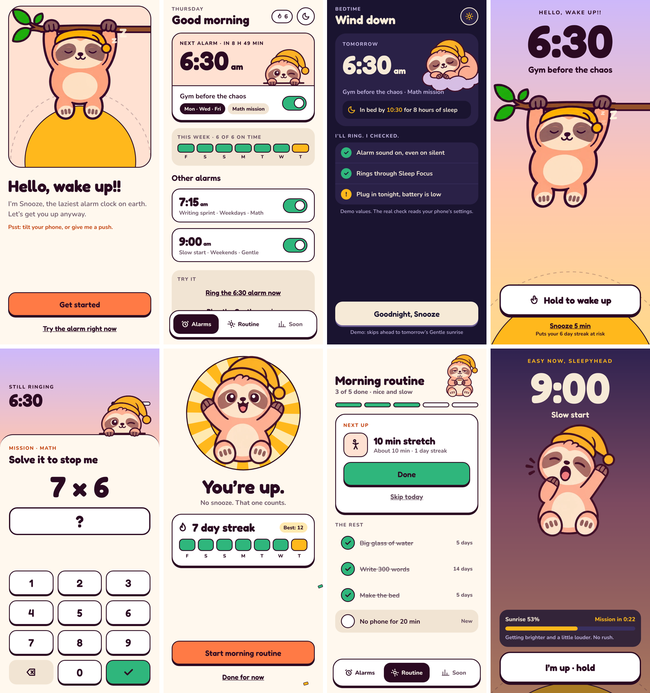

# Slothrise: Alarm & Habits

*Hello, wake up!!*

An alarm app with a lazy sloth called Snooze. You earn your way out of bed with a quick mission, then roll straight into a small morning routine. Gentle mode wakes light sleepers with a slow sunrise instead of a siren.



## What's here

| Folder | What it is |
|---|---|
| [`app/`](app/) | The Expo (React Native) app. Open it in Expo Go on your phone. See [`app/README.md`](app/README.md). |
| [`brand/`](brand/) | Logo, app icon, Snooze's head, the six pose illustrations, and the original source art. |
| [`appstore/`](appstore/) | Five App Store screenshots at 1290×2796 (iPhone 6.9"), plus an overview. |
| [`prototype/`](prototype/) | The first single-file web prototype (alarms, missions, Gentle mode, routine). Open `index.html` in a browser. |
| [`design/`](design/) | Source of the two design canvases: `v1-canvas` (first UX plan, 25 boards) and `v2-redesign` ("Cozy Sunrise": design thinking, design system, 9 screens). |
| [`tools/`](tools/) | Scripts used to make assets: the three alarm sounds, the App Store images, the dark-background logo and icon v2. |

## Run the app

```bash
cd app
```

```bash
npm install
```

```bash
npx expo start
```

Scan the QR code with Expo Go (iPhone Camera, or inside Expo Go on Android).

**The demo flow:** Welcome → Home (tap the moon for the bedtime view) → *Ring the 6:30 alarm now* → hold to wake → math mission → wake win → morning routine. *Play the Gentle sunrise* shows Gentle mode (15 s sunrise, mission at 30 s in the demo).

## Design: "Cozy Sunrise"

Drawn like Snooze: plum outlines, warm paper, one bright sun.

- **Follows the day.** Warm and light in the morning, dim and calm after 9 pm.
- **Colour is earned.** Sky gradients only on the ring, the sunrise and the win.
- **Tactile.** Buttons press down 4 px onto a hard plum shadow.
- **Half-asleep proof.** One big action on every wake screen.

| Token | Hex | Use |
|---|---|---|
| Paper | `#FFF8EE` | ground |
| Plum ink | `#2B0A22` | text, outlines, shadows |
| Sunrise | `#FF7A45` | main action |
| Sun | `#FFB81C` | streaks, rewards, hold fill |
| Leaf | `#2FB67C` | done |
| Night | `#1A1430` | bedtime |

Type: **Fredoka** for headings and times, **Nunito** for body text. All tokens live in [`app/src/theme.ts`](app/src/theme.ts).

## Status

Working in the app today: welcome, day and night home, the calm ringing screen with sound, the math mission, wake win with streak, morning routine, and Gentle mode with a rising volume.

Not built yet:
- The alarm editor (creating and saving your own alarms) and the Insights tab.
- Alarms that ring while the app is closed. This needs native alarm scheduling (AlarmKit on iOS, exact alarms on Android), so it needs a development build rather than Expo Go.
- Some values on screen are demo data (time until the next alarm, bedtime checks, streak history).

The Snooze illustrations are about 450 px each. Higher-resolution exports (2000 px or SVG) will make them crisp on modern phones.
